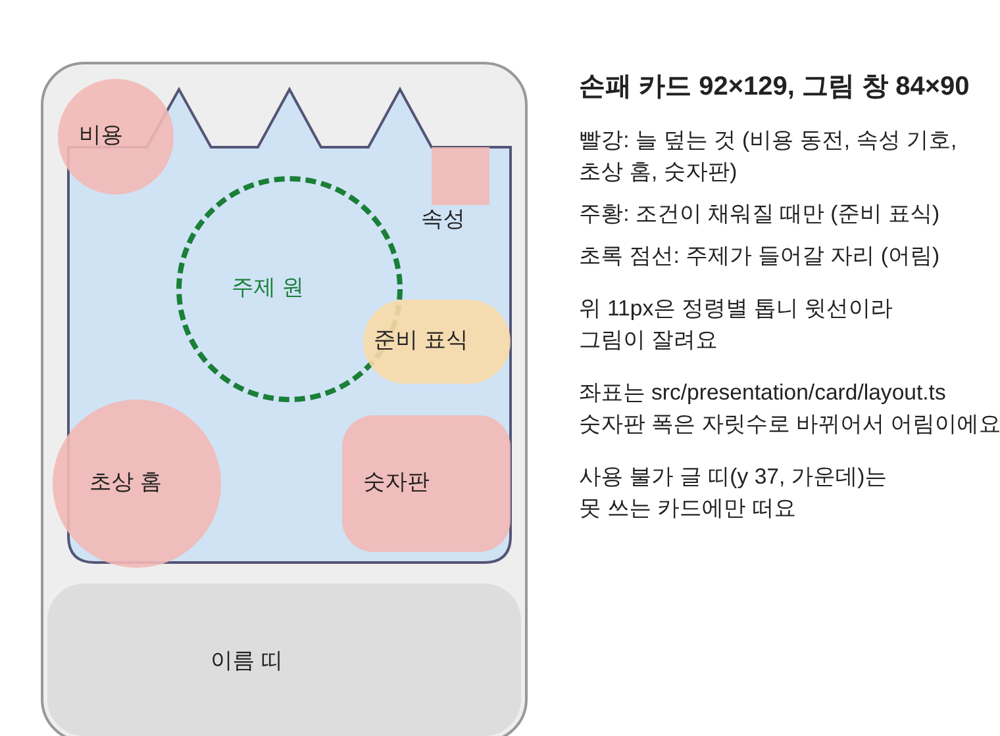

# 카드 일러스트 확보 파이프라인 (제안, Lucy 미검토)

- 날짜: 2026-11-06 · 📝 Claude 초안
- 근거: 카드 정본(0005·0008~0011, `src/presentation/card/layout.ts`), 카드 풀 정본 `design/canon/spirits/pool-second-wave.md`(0041, PR #55, 이름은 아직 `TODO_NAME`), 조사 `research/R4-card-illustration-conventions.md`(덱빌더 카드 그림 관행), `research/R5-novelai-v45-prompting.md`(NovelAI V4.5 Full), 기존 생성 기록 `assets/provenance.jsonl`(정령 일러스트·배경 감싸기 프롬프트).
- 이 문서의 시각 항목(구도, 화풍, 배경)은 모두 **제안**이에요. Lucy가 고르기 전에는 생성 라운드를 돌리지 않아요. 색·크기 값은 `TODO_TOKEN`.

## 0. 한 줄

**작은 창에서 읽히는 주제 하나를 가운데 위에 두고, 큰 원화 한 장을 손패용·확대용으로 두 번 잘라 쓴다.** 생성은 Lucy가 jjal에서, 시트·후처리·기록은 Claude가 맡아요.

## 1. 제약: 그림 창이 실제로 보이는 곳



- 손패 카드 92×129, 그림 창 84×90(거의 정사각, 살짝 세로). 위 11px은 정령별 톱니 윗선이라 잘려요.
- 네 모서리를 비용 동전·속성 기호·초상 홈·숫자판이 늘 덮어요. 조건이 채워지면 오른쪽 가운데에 준비 표식이 떠요. 남는 곳은 가운데 십자 모양이고, 가장 안전한 곳은 가운데보다 조금 위의 원이에요(R4 5-1).
- 주인 정령 얼굴은 초상 홈에 이미 있어요. 창 안의 두 번째 얼굴은 시선을 두고 초상과 다퉈요(R4 2장).
- 확대(호버·보상·덱 보기)에서는 덜 가려져서, 같은 원화를 덜 잘라 더 보여 줄 수 있어요(LoR 방식, R4 5-3).

## 2. Lucy가 정할 것 세 가지

### 결정 1. 그림에 무엇을 그리나 (구도 문법)

| | A. 정령이 시전하는 순간 | B. 사물·효과 하나 | C. 몸의 일부 + 효과 |
|---|---|---|---|
| 예 | 도롱뇽이 꼬리를 휘두름 | 유리 벽 한 장, 흩어지는 별가루 | 산양 뿔이 창 가장자리에서 들이받음, 조개 껍데기가 닫힘 |
| 닮은 사례 | LoR·Hearthstone 주문 | Slay the Spire 다수, Wildfrost 아이템 | Slay the Spire 아이언클래드 주먹, 사일런트 손과 단검 |
| 좋은 점 | 귀여움이 가장 커요. 확대 화면에서 매력이 커요 | 84×90에서 가장 잘 읽혀요. 12장이 주제로 쉽게 갈려요. 초상과 안 겹쳐요. AI 해부 오류가 가장 적어요 | 동세가 크고 형태가 굵어요. 얼굴 없이 정령 정체성(뿔·꼬리·껍데기)을 이어요 |
| 위험 | 같은 얼굴이 초상 홈과 창에 두 번. 같은 캐릭터 12장이 실제 크기에서 비슷해 보여요. 같은 정령 12포즈를 맞추는 게 NovelAI가 약한 곳이에요 | 그림 창에서 캐릭터 매력이 빠져요. 아이콘처럼 밋밋해질 수 있어요 | 별·프리즘처럼 몸 특징이 약하거나 추상적인 카드엔 안 맞아요. 잘린 곳에서 해부 오류가 잘 나요 |
| 생산 | 가장 비싸요 | 가장 싸요 | 중간 |

- **추천: B 기본 + C 일부.** 카드 이름이 몸 부위나 몸짓을 말하면 C(들이받기, 뿔 찍기, 꼬리 쓸기, 날름), 나머지는 B. 근거: 우리 카드는 "정령이 하는 행동"이고 누가 하는지는 초상 홈이 이미 말해요. Slay the Spire와 같은 조건이고, Mega Crit도 작은 화면에서 인간형 디테일이 안 읽혔다고 했어요(R4 1-2). 정령의 매력은 초상·필드·관리 화면이 맡아요.
- 다른 섞기: "B 기본 + A는 희귀만"은 희귀도에 연출 차등을 두지 않기로 한 0008과 부딪혀서 추천하지 않아요.

### 결정 2. 화풍 기준 (스타일 블록)

카드끼리, 그리고 정령 그림과 같은 게임으로 보여야 해요. 이미 Lucy가 쓴 블록이 두 개 있어요(`assets/provenance.jsonl`).

| | ① 정령 일러스트 블록 | ② 배경 감싸기 블록 | ③ 카드용 새 블록 |
|---|---|---|---|
| 무엇 | 정령 확정 그림의 작가 태그 묶음(rurudo·imoko·yukisame·wanke 등, V4.5) | 정령 배경 레이어의 작가 묶음(wanke·ask·ningen mame·kim hyung tae 등, V4.5 Full) + `game cg, majestic, rich textures` | ①이나 ②를 바탕으로 사물·효과에 맞게 몇 개만 바꿈 |
| 좋은 점 | 초상 홈·관리 화면의 정령과 붓질이 같아요 | 사람 없는 사물·풍경에서 이미 검증됐고, 모델이 4.5 Full로 같아요 | 카드에 맞춰 고를 수 있어요 |
| 위험 | 캐릭터 중심 블록이라 사물만 그리면 어떻게 나올지 몰라요 | 정령 그림과 질감이 조금 달라요 | 탐색 라운드가 하나 더 들어요 |

- **추천: ②로 시작하고 ①과 A/B 비교.** 카드 대부분이 B(사물·효과)라 ②의 "사람 없음" 경험이 바로 쓰여요. 첫 시험 라운드에서 같은 카드를 ①·②로 한 번씩 뽑아 Lucy가 고르면 그게 고정 블록이 돼요.
- 모델은 Lucy 말대로 **V4.5 Full**. 이유 하나 더: Precise Reference(정령 그림을 참조해 같은 생김새로)는 V4.5에서만 돼요(R5 0장). C 구도에서 뿔·꼬리 모양을 맞출 때 써요(참조 1개당 +5 Anlas).

### 결정 3. 창 안 배경

| | a. 단순 바탕 | b. 은은한 장면 | c. 속성 바탕 |
|---|---|---|---|
| 무엇 | 단색이나 아주 흐린 바탕 위 주제 하나 | 주제 뒤로 흐린 장소(하늘·바다·바위) | 속성마다 정해진 바탕 한 장 위에 주제 |
| 좋은 점 | 가장 잘 읽혀요. 누끼·재사용 쉬움 | 그림이 풍성해요 | 손패에서 속성이 한눈에 |
| 위험 | 밋밋해요 | 84×90에서 주제가 묻혀요(R4 2장 "배경 단순화") | 재질은 속성 전용이라(0005·0008) 이름 띠 재질과 말이 겹쳐요 |

- **추천: a, 단 정령마다 바탕 톤 하나.** 한 정령 12장이 같은 빛 방향·같은 바탕 처리를 쓰면 묶음으로 보이고(R4 3-3), 바탕 톤 자체는 시안에서 Lucy가 골라요(`TODO_TOKEN`).

## 3. 흐름

```
① 카드 브리프 (Claude)  →  ② 프롬프트 시트 (Claude)  →  ③ 생성 (Lucy, jjal)
        ↑                                                    ↓
⑦ 게임 연결 (Claude, 컨펌 뒤)  ←  ⑥ 출처 기록 (Claude)  ←  ⑤ 후처리 (Claude)  ←  ④ 고르기 (Lucy, 실제 크기 시트로)
```

| 단계 | 누가 | 무엇 | 만드는 것 |
|---|---|---|---|
| ① 브리프 | Claude | 카드마다 Focus 한두 단어(MTG 의뢰서 방식), 구도 문법(B/C), 결정적 형태, 피할 것. 이름은 작업명 기준이라 이름이 바뀌어도 그대로 | `design/card/art/rounds/<라운드>/briefs.json` |
| ② 시트 | Claude | 브리프 + 고정 화풍 블록 + 구도 틀 → jjal 러너 형식 시트. 카드마다 시드 4개 | `design/card/art/sheets/<라운드>.json` (jjal 형식은 맥 연결 후 맞춤) |
| ③ 생성 | Lucy | jjal 러너나 NAI 웹. 웹이면 **Download 버튼**으로 받아 메타데이터를 남겨요 | 원본 PNG |
| ④ 고르기 | Lucy | Claude가 만든 비교 시트에서 고름: 각 후보를 84×90 실제 크기로 카드 틀을 덮어서, 회색조로, 같은 정령 12장 나란히 | `tools/art/card-preview.mjs` → 시트 이미지 |
| ⑤ 후처리 | Claude | 주제 중심점 기준으로 손패용(84:90)·확대용 두 번 자르기, 크기별 webp, 안전 영역 검사(주제가 모서리 UI 밑에 들어가면 경고) | `tools/art/import_card_art.py` → `public/assets/cards/<owner>/<card>.webp` + 자르기 값 `cardArtFit.json` |
| ⑥ 기록 | Claude | PNG 메타데이터(Comment JSON·알파 채널 숨은 기록)에서 프롬프트·UC·시드·설정을 뽑아 `provenance.jsonl`에 자동으로 한 줄씩 | `import_card_art.py`가 함께 씀, `pnpm check:assets` 통과 |
| ⑦ 연결 | Claude | 손패 카드의 자리표시 사각형(`placeholderArt`)을 그림으로 바꿈. UI 작업이라 컨펌 뒤 | 별도 PR |

- 자르기 값은 정령 그림의 `spiritFit.json`처럼 사람이 고친 값을 따로 둬서, 다시 들여와도 지워지지 않게 해요(0023과 같은 방식).
- 주제 중심점은 처음엔 자동(그림의 밝기·채도 대비가 가장 큰 덩어리)으로 잡고, 어긋나면 Lucy가 고쳐요. 필요하면 정령 피팅 페이지처럼 카드 피팅 페이지를 붙일 수 있어요(나중 일).

## 4. 프롬프트 틀 (초안, 시험 전)

R5의 문법과 Lucy의 기존 시트를 따라요. 화풍 블록은 결정 2 뒤에 채워요.

```
[화풍 블록: 결정 2]
no humans, still life, object focus,
{Focus}, {결정적 형태},
1.2::single subject in the center, slightly above the middle, small and fully visible, lots of empty space around it::,
1.1::soft front lighting from slightly above::,
simple background, {바탕 톤: TODO_TOKEN} background,
very aesthetic, masterpiece, no text
```

- C 구도는 첫 줄을 `no humans, close-up, {부위} entering from the {방향} edge, motion` 식으로 바꾸고, 필요하면 정령 확정 그림을 Precise Reference로 붙여요.
- 해상도 1024×1024(정사각에 가장 가까워 잘리는 곳이 적고, Opus 무료 범위 안), 28스텝, Euler Ancestral·karras, Variety+ 끔.
- 품질 토글은 끄고 품질 태그를 직접 써요. 토글이 붙이는 `location`이 실제 장소 배경을 끌어와요(R5 1-2).
- UC는 V4.5 Full 프리셋에서 `negative space, blank page`를 뺀 것과 그대로인 것을 첫 라운드에서 비교해요. 이 두 낱말이 화면을 채우게 밀어서 "가운데 하나 + 여백"과 반대로 가요(R5 1-3).
- 넣지 않는 것: `chibi`(사물엔 의미 없고 캐릭터를 불러요), `translucent`(체형 실험에서 전체가 반투명해짐), 글자를 부르는 낱말(`sign`, `card`, `frame`).

## 5. 첫 라운드 (컨펌 뒤): 파일럿 18장 × 시드 4

넓게 펼쳐서 결정 1~3을 실물로 고르는 라운드예요.

| 정령 | 카드 (작업명) | 왜 |
|---|---|---|
| 유리 도롱뇽 | 유리 벽(B), 꼬리 휘두르기(C), 유리 파편(B) | 사물·몸짓·흩어지는 조각이 다 있어요 |
| 산양 | 박치기(C), 산사태(B, 장면에 가까움), 굳은 뿔(B/C 경계) | C가 가장 잘 맞는 정령 |
| 별 정령 | 별빛(B, 효과), 별자리(B, 추상) | C가 안 맞는 정령에서 B가 버티는지 |

- 8장 × 구도 2안(추천안 + 다른 안) + 화풍 비교 2장 = 18장, 카드마다 시드 4개 = 72장. 1024² 28스텝 한 장씩이면 Opus 무료 범위예요(R5 2-3). Precise Reference를 붙이는 장만 +5 Anlas.
- Claude가 실제 크기 비교 시트를 만들고, Lucy가 조각 단위로 골라요("유리 벽은 이 구도 + 저 화풍"). 고른 조각으로 다음 라운드를 좁혀요.
- 화풍·구도가 정해지면 정령 하나(12장)를 끝까지 뽑아 세트로 확인하고, 나머지 정령으로 넓혀요. 지금 정본 기준 72장(정령 5종 × 12 + 공용 8 + 별의 낙하 4)이에요.

## 6. 정할 것과 미룰 것

- 이름: 카드 이름은 PR #55에서 바뀌는 중이라, 파일·시트는 카드 id(작업명)로 묶어요. 이름이 바뀌어도 그림은 그대로예요.
- 공개: Steam은 미리 만든 AI 콘텐츠를 공개해야 해요(R4 3-2, R5 6장). provenance 기록이 그 근거예요. 덱빌더 커뮤니티가 AI 그림에 차갑다는 점(R4 3-2)은 Lucy가 알고 가야 할 위험이에요.
- 이용약관: NovelAI 약관 원문을 출시 전에 한 번 확인해요(R5 6장, 조사에서 전문을 못 읽었어요).
- jjal 시트 형식·NAI 노트(`~/workspace/jjal/docs/spirit-deckbuilder-nai5.md`)는 맥 연결 뒤 읽고 ② 형식을 맞춰요.

## 7. 게임에 넣기 (0042)
1. `design/card/art/picks.json`에 카드 한 줄: `id`(에셋 이름), `case_id`(고른 생성 결과), `composition`(object·symbol·scene·backdrop), `fit_size`(object·symbol만, 실물 크기 순서로 기존 카드 사이에 끼워 정함. scene·backdrop은 null).
2. 고른 원본 PNG와 `meta.json`(run_id·prompt·uc·seed·설정·image_sha256)을 한 폴더에 받아요. PNG는 바이트 그대로(메타데이터 보존).
3. `python3 tools/art/import_card_art.py <폴더>` → `public/assets/cards/<id>.webp`(512px), `assets/provenance.jsonl` 갱신.
4. 같은 명령이 `src/presentation/card/artIds.json`(그림이 있는 카드 id 목록)도 다시 써요. 카드 VM은 `cardArtOf(카드 id)`로 그림을 찾아요. `?scene=art`에서 확인해요.

## 8. 브리프 쓰기 (0063)
- 카드 이름을 그리지 않아요. 카드가 누구에게 무엇을 하는지(효과)와 분위기를 장면 한 문장, 비유한 상징 한 문장으로 써요.
- 장면엔 적(dark rock creature)·동료(small round ally creature)·정령을 효과대로 넣고, 얼굴·사람 손이 나오지 않게 해요.

