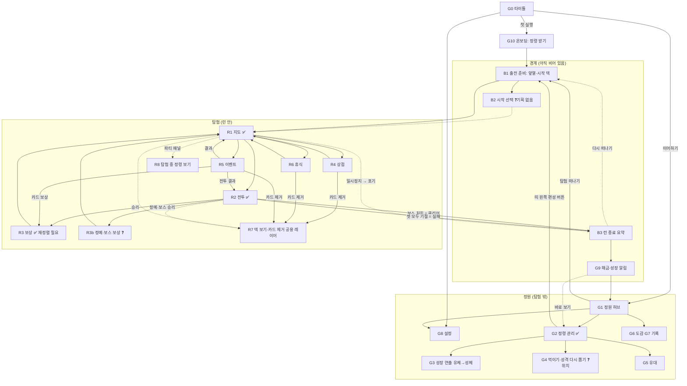

# 전체 화면 목록·흐름 리서치 (다음 디자인 라운드 고르기)

작성: 2026-10-29 · 용도: 확정된 화면(지도·전투·정령 관리·보상)을 넘어 게임 전체 화면을 한 장에 놓고, 다음 라운드를 고르기 위한 근거
읽은 것: `LEDGER.md`(10/29 12:30 + 전투 R5 19:28), `docs/handoff/01·02·03`, `DECISIONS.md`, `design-decisions/0004~0007`, `research/spirit-screen-ia.md`, `BRAND_BRIEF.md`, 캡처 `archive/r2-map/f03`, `archive/garden/f03`, `archive/battle5/frame-rest`
표기: **[출처]**는 아래 링크로 확인한 내용, **[미검증]**은 플레이 경험·통념이라 원문으로 확인하지 못한 내용이에요.
이 노트는 **정보 구조와 흐름**만 다뤄요. 레이아웃·색·글꼴·네이밍은 제안하지 않았고, 화면 이름은 기획 문서에 이미 있는 말을 썼어요. 새 이름이 필요한 곳은 "(가칭)"으로 적었어요. 모두 Lucy 컨펌 대상이에요.

---

## 0. 한눈에

- 화면은 크게 **정원 쪽(탐험 밖)**, **탐험 쪽(런 안)**, **경계(탐험의 앞과 뒤)** 세 덩어리예요. 확정된 화면은 거의 다 탐험 쪽(지도·전투·보상)과 정원 쪽 한 곳(정령 관리)에 몰려 있어요.
- **경계 화면(출전 준비, 런 종료, 해금 알림, 정원으로 돌아오기)이 하나도 정해지지 않았어요.** 그런데 훅 "정령을 키우면, 덱이 자란다"는 바로 이 경계에서 눈에 보여요. 탐험에서 무엇이 자랐고, 그게 다음 덱을 어떻게 바꾸는지가 여기서 이어지거든요.
- 추천 다음 라운드: **안 1 "자라는 순간"** = 런 종료 요약 + 해금·성장 알림 + 출전 준비(편성·시작 덱) + 보상 화면 다크 재정렬. 다만 기획 질문 3개(메타 재화, 레벨 유무, 성체 진화 시점)가 막고 있어서, 라운드 전에 Lucy 답을 먼저 받거나 작업 가정(🛠)을 화면 밖 메모로 달고 진행해야 해요.

---

## 1. 화면 목록

상태: **확정**(Lucy 확정, 장부 ✅) · **부분**(일부만 확정, 또는 확정됐지만 지금 정본과 어긋남) · **없음**(시안 없음)
"03 목록"은 `03_화면별_정보·행동_목록_미검토.md`에 정보·행동이 적혀 있다는 뜻이에요.

### 1-1. 정원 쪽 (탐험 밖)

| # | 화면 | 상태 | 꼭 보여줄 것 | 꼭 할 수 있어야 할 것 | 흐름 위치 |
|---|---|---|---|---|---|
| G0 | 타이틀 | 없음 | 게임 이름(미정), 이어하기 가능 여부 | 이어하기, 새로 하기(첫 실행), 설정, 종료 | 실행 직후. 03 목록은 "출전 준비"를 타이틀로 썼는데, 둘은 나누는 게 장르 관례예요(§2-2) |
| G1 | 정원 (홈 허브) | 없음 (기획서: MVP는 "메뉴 화면 1개") | 정령들, 할 일 배지(성장 가능·새 카드·유대), 재료·재화, 탐험 떠나기 입구 | 정령 관리로, 출전 준비로, 도감·설정으로, (먹이기·성격 다시 뽑기의 자리일 수 있음) | 런이 끝나면 돌아오는 곳. 메타 루프의 중심 |
| G2 | 정령 관리 (목록 띠 + 상세 패널) | **확정** (0006, R4 v5) | 장부 3-1~3-2 그대로 | 탭 개요·성장 길·카드 n/m·유대 n/3, 키우기(성장 길 안), 편성 버튼(띠 왼쪽) | 정원에서 들어감. 런 종료 후 "무엇이 자랐나"를 확인하러 가장 많이 옴 |
| G3 | 성장(진화) 연출: 유체 → 성체 | 없음 | 단계 변화, 일러스트 변화, **성격 공개**, 능력치 변화, 해금된 카드 | 넘기기, 카드 보기 | 성장 길에서 키우기를 누른 직후 (또는 탐험 중, 기획 질문 Q3). 트레일러의 "보여줄 순간"(BRAND_BRIEF)이라 비중이 커요 |
| G4 | 먹이기·성격 다시 뽑기 | 없음 (자리 없음, 장부 3-3) | 재료 보유량, 비용, 결과 미리보기(성격은 무작위) | 먹이기, 다시 뽑기, 취소 | 장부 질문 3. 정령 관리 안 / 정원 / 별도 화면 중 미정 |
| G5 | 유대 에피소드 보기 | 부분 (유대 탭 자리만) | 에피소드 목록 n/3, 해금 조건 | 읽기 | 정령 관리 유대 탭 안 |
| G6 | 도감 (카드·적·성격) | 없음 | 카드 전체(배운 적 있음/해금됨/잠김), 적, 성격 8종 | 둘러보기, 해금 조건 확인 | 정원 또는 타이틀에서. **정령 도감 빈칸은 기각**(3-4)이라, 정령은 넣지 않고 카드·적만 다루는 게 맞아요 |
| G7 | 기록·통계 (가칭) | 없음 | 지난 탐험 기록, 최고 기록, 업적 진행 | 둘러보기 | 도감 안의 탭으로 충분 (장르 관례: StS 기록·Balatro 통계 [미검증]) |
| G8 | 설정 | 없음 | 화면·소리·언어·조작(컨트롤러), 턴 종료 확인 끄기(0005에서 약속), 애니메이션 속도 | 바꾸기, 되돌리기 | 어디서나(타이틀·정원·탐험 중 일시정지) |
| G9 | 해금 알림 / 해금 기록 | 없음 | 무엇이 열렸나(카드가 보상 후보에 추가됨, 새 정령, 도전 모드), 조건 | 확인, 바로 보러 가기 | 런 종료 직후 또는 정원 진입 시. §2-6 |
| G10 | 첫 실행 온보딩·튜토리얼 | 없음 | 정령 받기, 첫 전투 안내(마력·의도·조준 미리보기), 첫 보상 안내("누가 배울까") | 따라 하기, 건너뛰기 | 새로 하기 → 첫 탐험 안에 섞음 |

### 1-2. 경계 (탐험의 앞과 뒤)

| # | 화면 | 상태 | 꼭 보여줄 것 | 꼭 할 수 있어야 할 것 | 흐름 위치 |
|---|---|---|---|---|---|
| B1 | 출전 준비 (편성 + 시작 덱) | 부분 (편성 = 띠 왼쪽 버튼으로만 결정. 출전 편성 모드 E는 **복원하지 않음**) | 출전 3자리와 앞열, 정령별 속성·역할·단계·성격, **합쳐진 시작 덱 장수와 구성**, (도전 모드면) 난이도 | 정령 바꾸기, 앞열 정하기, 덱 보기, 탐험 떠나기, 뒤로 | 정원 → 출전 준비 → 지도. MVP는 정령이 3종뿐이라 "셋 고르기"가 사실상 없고, 앞열 선택 + 시작 덱 확인이 실질 내용이에요 |
| B2 | 탐험 시작 선택 (가칭, 장르 관례 "첫 축복") | 없음, 기획에도 없음 | 2~4개 시작 보너스 | 하나 고르기 | 선택 사항. StS 니오우 관례(§2-2). 넣을지 기획 질문 |
| B3 | 런 종료 요약 | 없음 (03 목록: 클리어/실패, 칸 수, 덱 장수, 골드) | 결과, 지나온 길, **정령별 이번 탐험에서 배운 카드**, 최종 덱, 가져가는 것(재료·경험), 다음 해금까지의 진행 | 정원으로, (같은 정령으로) 다시 떠나기, 덱 다시 보기 | 보스 처치 또는 셋 모두 기절 → 런 종료 → G9 → G1 |

### 1-3. 탐험 쪽 (런 안)

| # | 화면 | 상태 | 꼭 보여줄 것 | 꼭 할 수 있어야 할 것 | 흐름 위치 |
|---|---|---|---|---|---|
| R1 | 지도 | **확정** (R2 C, 0005) · 재정렬 필요(§4) | 03 목록 + 가까운 길·미니맵·파티 패널 | 다음 칸, 덱 보기, 설정 | 탐험의 허브. 모든 칸에서 돌아옴 |
| R2 | 전투 | **확정** (R5, 0007) | 장부 2 | 장부 2 | 전투·정예·보스 칸 |
| R3 | 전투 보상 | **확정이지만 어긋남** ("정원 그림책", 밝은 종이) | 골드, 카드 후보 3장, 카드별 배울 수 있는 정령과 최종 수치 | 카드 1장 + 배울 정령, 건너뛰기 | 전투 승리 직후. **훅이 런 안에서 가장 직접 보이는 화면** |
| R3b | 정예·보스 보상 | 없음 | 일반 보상 + α. 지도 R2 C 시안은 정예 보상을 "카드 + 유물"로 적었는데 **기획서에 유물이 없어요** | — | 기획 질문 Q9 |
| R4 | 상점 | 없음 (03 목록) | 판매 카드 5장·가격·**정령별 수치**, 골드, 카드 제거·치료 가격과 사용 여부 | 구매(+ 배울 정령), 카드 제거, 치료, 떠나기 | 상점 칸. 구매 = 보상 화면의 "누가 배울까" 흐름 재사용 |
| R5 | 이벤트 | 없음 (03 목록) | 제목, 상황 글, 선택지와 결과 설명(대가 포함) | 고르기 → 결과 → 보상/카드 제거로 이어짐 | 이벤트 칸 |
| R6 | 휴식 | 없음 (03 목록) | 정령별 HP와 회복 후 HP, 제거 후보 | 쉬기(30%) 또는 카드 1장 제거 | 휴식 칸 |
| R7 | 덱 보기 / 카드 제거 | 없음 (03 목록) | 카드 목록(**주인 정령별**), 최종 수치, 정렬 | 닫기 / 제거 모드에서 1장 고르기와 확인 | 지도·전투·상점·휴식·이벤트·출전 준비·런 종료 어디서나 여는 공용 레이어 |
| R8 | 탐험 중 정령 보기 (가칭) | 없음 | 정령 HP, 이번 탐험에서 배운 카드, 싱크·성격 | 닫기 | 지도 파티 패널에서 정령을 누르면. 정령 관리(G2)의 축약판을 재사용 가능 |
| R9 | 일시정지 | 없음 | — | 계속, 설정, 포기(런 종료), 저장 후 종료 | Esc. 어디서나 |
| R10 | 각성 컷인, 보스 2페이즈 | 연출 (전투 안) | — | — | 전투 화면 위 연출. 화면 라운드 대상 아님 |
| R11 | 카드 상세 팝업 | 부분 (전투 호버 H1) | 카드 전체 설명, 정령별 수치, 계산 줄 | 닫기 | 덱 보기·보상·상점에서 공용 |

### 1-4. 숫자로

- 화면 23개(연출·레이어 포함) 중 **확정 4** (정령 관리, 지도, 전투, 보상), **부분 4** (출전 준비, 유대, 카드 상세, 보상=확정이지만 어긋남), **없음 15**.
- 03 목록에 정보·행동이 이미 적힌 화면: 출전 준비, 지도, 전투, 보상, 상점, 이벤트, 휴식, 덱 보기, 런 종료 (9개). 그 밖은 이 노트에서 처음 목록에 올렸어요.

---

## 2. 전체 흐름

흐름에서 눈여겨볼 점
1. **훅의 고리**는 `보상(누가 배울까) → 런 종료(무엇이 자랐나) → 해금 알림 → 정령 관리(키우기) → 출전 준비(덱이 이만큼 자랐다)`예요. 이 다섯 칸 중 확정은 보상·정령 관리 둘이고, 보상은 다크 정본과 어긋나 있어요.
2. **덱 보기(R7)는 화면이 아니라 레이어**예요. 탐험 쪽 거의 모든 화면이 열어요. 카드 제거(상점·휴식·이벤트) 세 곳이 같은 레이어를 써야 해서, 상점·휴식보다 먼저 정하는 게 효율적이에요.
3. **"누가 배울까" 고르기**는 보상·상점·(카드를 주는) 이벤트 세 곳에 나와요. 보상 화면에서 정한 조각을 그대로 재사용하게 돼요.
4. 정원 허브(G1)와 정령 관리(G2)의 관계가 비어 있어요. 기획서는 정원을 "MVP에서 메뉴 한 화면"이라고 했고, 장부는 "정원을 목록으로 쓰기"를 **보류**했어요. 정령 관리가 사실상 정원 첫 화면이 될지, 그 위에 허브가 있을지가 기획 질문 Q6이에요.

---

## 3. 장르 관례 조사

### 3-1. 런 사이 홈 허브

| 게임 | 허브 형태 | 무엇이 잘 되나 |
|---|---|---|
| Hades II | 걸어 다니는 공간(교차로). 가마솥에서 주문(incantation)을 만들면 **정원 밭·낚시터·온천·상점 같은 새 장소가 열려요**. 진 뒤에는 천막의 마법진으로 돌아와요 [출처: Hades Wiki] | 해금이 "메뉴 항목 추가"가 아니라 **공간이 자라는 것**으로 보여요. 돌아오는 곳이 매번 같아서 "무엇이 늘었나"가 눈에 띄어요. 인물과의 대화가 허브의 보상 [출처 일부, 대화는 미검증] |
| Wildfrost | 마을 스노드웰. 건물마다 하나의 기능: 부족 회관, 펫 하우스, 발명가 오두막(아이템), 온천(동료), 쇄빙선 오두막(지도 이벤트), 도전 사당, 일일 탐험 비행선. **건물마다 다음 도전 과제가 하나씩** 떠 있고 순서대로 열려요 [출처: Wildfrost Wiki] | 해금 목록을 **기능별 건물**로 나눠서, "다음에 무엇이 열리나"가 늘 한 줄로 보여요. 해금 대상 = 런 보상 풀(동료·아이템·이벤트)이라는 점이 우리 "카드풀 해금"과 같아요 |
| Slay the Spire 2 | 메인 메뉴에서 여는 **타임라인**. 조건을 채운 에포크는 "받을 준비 됨"으로 떠 있고, **플레이어가 눌러야** 해금이 적용돼요 [출처: clawsomegamer] | 해금을 런 종료 화면에서 몰아 보여 주지 않고, 플레이어가 원할 때 하나씩 "받는" 의식으로 만들어요 |
| Slay the Spire 1 | 허브 없음. 메인 메뉴 → 캐릭터 선택. 점수가 쌓이면 캐릭터별 카드·유물 해금 [출처: StS Wiki Score] | 허브가 없어도 된다는 예. 대신 런 사이 시간이 짧아요 |
| Monster Train 1·2 | 허브 없음. 클랜 선택 화면이 곧 메타 화면. 클랜을 쓸수록 그 클랜의 카드·유물·챔피언이 열려요 [출처: BlueStacks 가이드] | 메타 진행을 **고르는 대상(클랜) 옆**에 붙여서, 런 시작 화면이 곧 진행 화면이에요 |
| Cassette Beasts | 마을(하버타운)이 실제 오픈월드의 일부. 기록·파티 관리는 메뉴 [미검증] | 비교작이지만 로그라이트 허브 구조는 아니에요 |
| 포켓몬 / 가챠 | 포켓몬은 센터(회복)·박스(보관)가 분리. 가챠는 홈 화면 = 대표 캐릭터 일러스트 + 메뉴 + 빨간 점 배지 [미검증, 업계 통념] | 홈에 **대표 캐릭터 하나를 크게** 세우는 관례. 우리 정령 관리의 전면 일러스트와 맞닿아요 |

**정리**: 허브는 두 갈래예요. (가) 공간형(Hades, Wildfrost) — 해금이 장소·건물로 보이고 애착이 생기지만 만들 게 많아요. (나) 메뉴형(StS, Monster Train) — 런 시작 화면과 해금 화면이 곧 허브예요. 1인 개발 MVP의 "정원 = 메뉴 한 화면"은 (나)에 가깝고, 정령 관리 화면의 전면 일러스트가 가챠 홈 관례처럼 허브 역할을 대신할 수 있어요. 이건 Lucy 결정 대상이에요(Q6).

### 3-2. 런 시작 / 파티 고르기

| 게임 | 흐름 | 무엇이 잘 되나 |
|---|---|---|
| Wildfrost | 부족 → **리더 셋 중 하나**(외모·능력치·능력 무작위) → 펫 하나 [출처: Wildfrost Wiki Getting Started] | 고르기 단계를 2~3개로 쪼개고, 단계마다 후보를 적게 줘요 |
| Monster Train 2 | 주 클랜 + 보조 클랜(순서가 중요, 132조합). 챔피언은 주 클랜에서 와요 [출처: dood.gg] | "가장 중요한 카드(챔피언)"를 고르는 순간에 보여 줘요 → 우리 "출전 정령 = 덱의 3분의 1"과 같은 무게 |
| Slay the Spire | 캐릭터 + 승천 단계 → 첫 칸에서 니오우가 시작 보너스 4개(카드 관련 / 일반 / 대가 있는 큰 보상 / 보스 유물 교환). 이전 런에서 1막 보스에 못 갔으면 2개만 [출처: StS Wiki Neow] | 시작 덱이 늘 같아도 첫 선택으로 런마다 다르게 출발. 실패한 사람에게 쉬운 선택지를 줘요 |
| Inscryption (Kaycee's Mod) | 시작 덱(카드 3장 + 토끼 가죽 2) 고르기 + 선택 도전 과제. 도전을 충분히 켜고 깨면 새 카드·새 시작 덱·새 도전 해금 [출처: Superjump] | 난이도를 "단계 하나"가 아니라 **켜고 끄는 조각**으로 줘요 |
| Hades II | 출발 전 교차로에서 무기·아르카나 카드·기념품을 직접 걸어가 고름 [미검증] | 고르기가 허브 공간과 붙어 있어요 |

**정리**: 공통으로 런 시작 화면에는 ① 고르는 대상(캐릭터·클랜·리더), ② 그 선택이 만드는 **시작 덱**, ③ 난이도가 있어요. 우리 게임은 ①이 "정령 셋 + 앞열", ②가 "합쳐진 시작 덱"이에요. 시작 덱 미리보기는 훅("덱이 자란다")을 런 첫 화면에서 보여 줄 기회예요. MVP는 정령이 3종뿐이라 ① 고르기가 없으니, 정령이 늘어날 때의 구조(3/N)를 미리 잡아 두는 정도면 돼요.

### 3-3. 상점

| 게임 | 구성 | 잘 되는 점 |
|---|---|---|
| Slay the Spire | 캐릭터 카드 5 + 무색 카드 2 + 유물 3 + 포션 3, **카드 제거는 상점당 1회** [출처: StS Wiki Map Locations] | 판매 품목을 종류별 줄로 나눠, 상인 앞 한 화면에서 다 보여요. 카드 제거가 상점의 핵심 서비스 |
| Monster Train | 상점이 종류별로 갈라짐(유닛 강화, 주문 강화, 복제·제거) [미검증] | "무엇을 사러 왔나"를 칸 선택에서 이미 정해요 |
| Balatro | 라운드 사이마다 상점. 조커·카드·팩·바우처, **새로고침(reroll)** [미검증] | 상점이 런 리듬의 중심 |

**우리 게임 시사**: 03 목록의 상점은 카드 5장 + 카드 제거 + 치료예요. 카드를 사면 **"누가 배울까"** 를 다시 골라야 해서, 상점 = 보상 화면의 "카드 + 배울 정령" 조각 × 5 + 가격이에요. 보상 화면을 먼저 다크로 재정렬하면 상점은 그 조각을 늘어놓는 일이 돼요.

### 3-4. 휴식

| 게임 | 구성 | 잘 되는 점 |
|---|---|---|
| Slay the Spire 1 | 쉬기(최대 HP 30%) 또는 대장간(카드 1장 강화), **한 번에 하나만** [출처: StS Wiki] | 둘 다 좋은 선택지라 매번 진짜 고민 |
| Slay the Spire 2 | 쉬기·대장간 기본, 유물·이벤트로 파기·카드 제거·복제·일시 강화가 붙어요 [출처: untapped.gg] | 기본 2개 + 상황 따라 늘어나는 칸 |
| Wildfrost | 회복은 전투 중 동료를 손패로 불러들이는 방식, 휴식 칸 대신 (털복숭이 달팽이 같은) 쉼터 이벤트 [출처 일부: Wildfrost Wiki] | — |

**우리 게임 시사**: 03 목록은 "쉬기(30%) 또는 카드 1장 제거"예요. StS의 "강화" 자리에 "제거"가 들어간 구조예요. 정령이 셋이라 **정령별 HP 변화 a→b**(전투 R5의 받을 피해 표기와 같은 꼴)를 보여 주는 게 판단 정보예요. 기본 모드에서 "쓰러진 정령은 HP 1로 복귀"라서, 휴식 직전 HP 1인 정령이 흔할 거예요. 도전 모드의 "깨우기(비싼 대가)"도 이 화면에 들어올 자리예요(기획서).

### 3-5. 이벤트

- StS: "?" 칸은 이벤트·전투·상점·보물 중 하나가 되고, 안 나온 종류일수록 확률이 오르는 보정 [출처: StS Wiki]. 이벤트 화면은 그림 + 글 + 선택지 버튼, 버튼에 대가와 결과가 한 줄로 [미검증, 통념].
- Wildfrost: 이벤트 종류가 도전 해금으로 늘어나요(쇄빙선 오두막) [출처].
- **우리 게임 시사**: 이벤트 결과가 보상·카드 제거·전투로 이어지니, 이벤트 화면 자체는 "글 + 선택지"로 얇게 두고, 결과는 공용 화면(보상·덱 보기·전투)으로 넘기는 게 재사용에 좋아요. 정원 세계관 글을 쓰는 곳이라 **브랜드 톤(다정함·동화적 2)** 이 가장 많이 드러나는 화면이기도 해요.

### 3-6. 런 종료 요약과 해금 알림

| 게임 | 런 종료에 보이는 것 | 해금 알림 |
|---|---|---|
| Slay the Spire 1 | 점수 항목별 목록(층 ×5, 처치 수, 정예·보스, 속도, 골드, 덱 조건 보너스 등) → 점수가 캐릭터 해금 막대를 채움 [출처: StS Wiki Score] | 막대가 차면 카드 3장·유물 묶음 해금 화면 [미검증] |
| Slay the Spire 2 | 오른 층, 처치한 정예, 얻은 골드 [출처: clawsomegamer] | 런 종료에서 바로 주지 않고 **타임라인에서 "받을 준비 됨"** 으로 [출처] |
| Balatro | 런이 끝나면 최고 점수 핸드, 가장 많이 낸 핸드, 시드 같은 기록 + 새로 하기 [미검증]. 해금은 런 중 실시간 판정, 일부는 다음 런부터 적용, 조건은 메인 메뉴 수집품 화면에서 확인 [출처: dood.gg] | 해금된 순간 짧은 알림 [미검증] |
| Inscryption (Kaycee's Mod) | 도전을 충분히 켜고 클리어하면 새 카드·시작 덱·도전 해금 [출처: Superjump] | — |
| Hades II | 진 자리에서 바로 허브로. 요약 화면 대신 **허브 인물이 그 런에 반응** [미검증] | 해금 = 가마솥 주문, 필요한 재료가 모이면 표시 [출처 일부] |
| Monster Train | 클랜 경험치 막대가 차오르고 레벨 업 시 해금 카드 표시 [미검증] | — |

**공통 관례**
1. 런 종료는 **"결과 → 이번 런 기록 → 메타 진행이 차오르는 모습 → 해금"** 순서예요. 진행 막대가 차오르는 애니메이션이 실패한 런에도 보상감을 줘요 [미검증, 통념].
2. 해금 알림은 두 방식이에요. (가) 런 종료 직후 몰아서(StS1, Monster Train), (나) 허브에서 직접 받기(StS2 타임라인, Hades 가마솥). (나)는 런 종료 화면을 가볍게 하고 허브로 가는 이유를 줘요.
3. 해금 대상이 **"런 보상 풀에 추가됨"** 일 때(StS 카드, Wildfrost 동료, 우리 카드풀 해금) 알림은 "이제 보상 후보에 나와요"라는 **효과**를 말해야 해요. 덱에 바로 들어가지 않는다는 규칙(DECISIONS 3)을 플레이어가 오해하기 쉬운 지점이에요.

**우리 게임 시사**: 런 종료에서 꼭 보여야 할 우리만의 정보는 **정령별로 이번 탐험에서 배운 카드**예요. "세 정령이 각자 무엇을 배웠나"가 훅을 한 장에 담아요. 장부 5의 R4 리뷰 지적 "이번 탐험에서 바뀐 것 보기 없음"도 여기서 풀려요.

### 3-7. 그 밖의 장르 표준 화면

- **도감**: StS·Balatro·Wildfrost 모두 카드(와 적) 도감이 있고, 해금 조건을 도감에서 확인해요 [출처: Balatro는 dood.gg, Wildfrost 건물별 확인은 Wiki]. 우리는 정령 도감 빈칸이 기각됐으니 **카드·적 도감**만.
- **설정**: 카세트 비스트 UI 리디자인 글은 설정 목록에 스크롤 표시가 없고, 뒤로·저장 위치가 반대라는 점을 문제로 들어요 [출처: Medium]. 우리는 0005에서 "턴 종료 확인(설정에서 끔)"을 이미 약속했어요.
- **튜토리얼**: 덱빌더는 첫 런 안에 섞는 게 보통이에요(StS 첫 전투 말풍선, Wildfrost 첫 런 고정 진행) [미검증]. 우리 정보 원칙("익히는 정보는 기호·호버")이 성립하려면 **처음 몇 판에 기호를 가르치는 장치**가 필요해요.

---

## 4. 확정 화면의 정본 재정렬

정본 = 다크 "무채 유리 + 한 가지 강조(자두빛)", Orbit 단일, 확정 카드(그림 창 + 얇은 이름 띠, 5:7, SD 초상 홈, 재질), 정령 관리의 원형 얼굴 띠, 전투 R5의 표기 규칙(a→b, ▲ 성장).

| 화면 | 어긋남 | 재정렬 양 |
|---|---|---|
| **보상 (정원 그림책)** | 밝은 종이 바탕, 파스텔 카드 블록에 효과 글이 그대로(카드 확정 전 구조), 정령 얼굴이 도형, 이름이 옛 초안(마리나), 수치 계산 줄은 이미 있음 | **큼**. 뼈대("카드 3장 위, 카드마다 배울 정령 3칸, 아래 확정 띠와 덱 23→24")는 살리고, 바탕·카드·정령 얼굴을 정본으로 다시 그려야 해요. 밝은 종이 → 다크로 바꾸면 "그림책"의 질감이 남을지가 Lucy 판단 대상이에요 |
| **지도 (R2 C)** | 이미 어두운 글래스. 다만 강조색이 금빛(자두빛 아님), 글꼴이 Orbit 전, 왼쪽 파티 패널이 HP 막대 + 덱 장수 + 싱크 막대 카드형(정령 관리의 원형 얼굴 띠와 다른 말투), 정예 보상에 "유물" 표기(기획에 없음), "위험 보통/높음" 같은 문장 라벨 | **중간**. 뼈대(가까운 길 + 미니맵 + 오른쪽 칸 정보)는 그대로. 강조색·글꼴 교체, 파티 패널 말투를 정령 관리 띠·전투 HP 칸과 맞추기, 받을 피해 범위 표기(19→15~17)를 전투 R5의 a→b와 같은 꼴로 |
| **전투 (R5)** | 정본과 가장 가까움(10/29 저녁 작업). 확인할 것: 강조색이 자두빛인지, 글꼴이 Orbit인지, 정령이 별·여우·해파리(Lucy 에셋)라 MVP 데이터(이그니·테스투·실바)와 이름·속성이 다름 | **작음** (확인 위주) |
| **정령 관리 (R4 v5)** | 정본의 출처라 맞음. 남은 것은 장부 5의 리뷰 고칠 거리 | 작음 |
| **카드** | 정본 | 없음. 단, 보상·상점·덱 보기에서 쓰는 "큰 카드(효과 설명 보이는 상태)"는 아직 안 그렸어요 (호버 H1 말풍선만 있음) |

**공통 정리 과제**: 정령 이름·속성이 화면마다 달라요(지도: 실바·이그니·마리나 / 보상: 이그니·실바·마리나 / 전투: 별·여우·해파리 / 데이터: 이그니·테스투·실바). 네이밍은 Lucy 결정 대상이지만, 다음 라운드부터 **한 세트로 통일**하는 작업 가정이 필요해요.

---

## 5. 다음 디자인 라운드 후보

판단 기준: ① 훅 "정령을 키우면, 덱이 자란다"에 주는 효과, ② 열린 기획 질문에 막히는 정도, ③ 확정 조각 재사용.

### 안 1 "자라는 순간" — 보상 재정렬 + 런 종료 + 해금·성장 알림 + 출전 준비 (추천)

- 담을 화면: R3 보상(다크·확정 카드로), B3 런 종료(클리어/실패 둘 다), G9 해금 알림, B1 출전 준비(앞열·시작 덱), (선택) G3 유체→성체 연출의 한 장면
- **좋은 점**
  - 훅의 고리 다섯 칸 중 비어 있는 셋을 채우고, 어긋난 보상까지 맞춰요. 처음으로 "탐험 → 정원 → 탐험" 한 바퀴가 한 아티팩트에 들어가요.
  - 확정 조각 재사용이 많아요: 정령 관리의 원형 얼굴 띠·단계 링(런 종료의 정령별 진행), 카드(보상·시작 덱), 전투의 a→b·▲ 표기(런 종료의 성장 표시), 지도 미니맵(런 종료의 지나온 길).
  - 장부 5 리뷰 지적 "이번 탐험에서 바뀐 것 보기 없음"을 해결해요.
  - BRAND_BRIEF의 "보여줄 순간"(유체가 성체가 되며 성격 공개)을 처음 화면으로 만들 수 있어요.
- **나쁜 점**
  - 기획 질문에 가장 많이 막혀요(아래). 답 없이 그리면 화면이 "작업 가정"으로 가득해져요.
  - 출전 준비는 "출전 편성 모드(E)를 살리지 않음" 결정과 맞물려서, 띠 왼쪽 버튼이 여는 화면의 모양을 새로 정해야 해요. E를 새 근거 없이 되살리지 않도록 주의해야 해요.
- **막는 기획 질문**: Q1 메타 재화(탐험에서 무엇을 가져오나), Q2 레벨 유무(장부 질문 2), Q3 성체 진화 시점, Q4 편성 위치(장부 질문 4), Q5 해금 받는 방식, Q7 앞열을 출전 준비에서 정하나

### 안 2 "길 위의 칸들" — 상점 + 이벤트 + 휴식 + 덱 보기·카드 제거 (+ 보상 재정렬)

- 담을 화면: R4 상점, R5 이벤트, R6 휴식, R7 덱 보기·카드 제거 레이어, R11 큰 카드, R3 보상 재정렬
- **좋은 점**
  - 03 목록에 정보·행동이 다 적혀 있어서 기획 질문에 거의 막히지 않아요.
  - 버티컬 슬라이스(1막 한 판)를 처음부터 끝까지 돌리려면 반드시 필요한 화면들이에요. 지금 프로토타입(`src/scenes`)에 Shop·Event·Rest·Deck 씬이 플레이스홀더로 있어요.
  - "카드 + 배울 정령" 조각(보상) 하나를 정하면 상점이 따라오고, 덱 보기 레이어 하나를 정하면 제거 세 곳이 따라와요. 재사용 효율이 가장 높아요.
- **나쁜 점**
  - 훅에 주는 효과는 중간이에요(상점의 "누가 배울까" 정도). 수집·육성 타깃이 오래 머무는 화면이 아니에요.
  - 개별 화면이 장르 관례대로 수렴하기 쉬워서, 컨셉 4~5개를 서로 다른 축으로 벌리기 어려워요.
- **막는 기획 질문**: Q9 정예·보스 보상과 유물 유무, Q8 도전 모드 "깨우기"를 휴식에 넣나, (작음) 상점 새로고침 유무

### 안 3 "정원으로 들어가는 문" — 타이틀 + 정원 허브 + 도감 + 설정 + 첫 실행

- 담을 화면: G0 타이틀, G1 정원 허브, G4 먹이기·성격 다시 뽑기, G6 도감, G8 설정, G10 첫 실행
- **좋은 점**
  - 첫인상과 스팀 스크린샷에 직결돼요. 퍼블리셔 페르소나 지적("첫 스크린샷의 AI 티")에 대응할 화면이에요.
  - 정원 허브를 정하면 장부 질문 3(먹이기 자리)이 풀려요.
- **나쁜 점**
  - 게임 이름·로고가 미정이라 타이틀은 자리표시만 돼요.
  - 정원을 공간으로 할지 메뉴로 할지가 아트(배경·Spine) 범위를 크게 바꿔요. 1인 개발 범위 결정이 먼저예요.
  - 정령 관리 화면과 역할이 겹쳐서, 이미 확정한 정령 관리 뼈대를 흔들 위험이 있어요.
- **막는 기획 질문**: Q6 정원 = 정령 관리인가 별도 허브인가, Q1 메타 재화, 장부 질문 3, 게임 이름

### 추천과 순서

1. **안 1을 다음 라운드로** 권해요. 훅이 실제로 보이는 곳이 경계 화면인데 거기가 통째로 비어 있고, 보상 재정렬도 같이 끝나요.
2. 다만 라운드 전에 **Q1·Q2·Q3** 세 가지는 Lucy 답을 먼저 받는 걸 권해요. 셋 다 "런 종료에 무엇이 차오르는가"를 정해서, 답이 없으면 컨셉끼리 차이가 화면 구성이 아니라 기획 가정의 차이가 돼 버려요. 답을 못 받으면 컨셉마다 같은 작업 가정(🛠)을 쓰고 화면 밖 메모 레이어에 적어요(R4 방식).
3. 안 2는 기획 의존이 낮아서, 안 1의 기획 질문을 기다리는 동안 또는 바로 뒤에 돌리기 좋아요. 안 3은 게임 이름과 정원 형태가 정해진 뒤로 미뤄요.

---

## 6. 기획 질문 (Lucy 확인 필요)

장부 4의 질문과 겹치는 것은 번호를 함께 적었어요.

| # | 질문 | 막는 화면 | 장부 |
|---|---|---|---|
| Q1 | 탐험이 끝나면 무엇을 가져오나요? (재료 종류, 실패해도 가져오나, 골드는 사라지나) | 런 종료, 정원, 먹이기 | 새 질문 (기획서 "탐험에서 가져온 재료") |
| Q2 | 별도 레벨(Lv2·Lv3)이 있나요? 해금 예시("이그니 레벨 3이 되면 인첸디움")가 레벨 기준이에요 | 런 종료 진행 막대, 해금 알림, 성장 길 | 질문 2 |
| Q3 | 유체 → 성체 진화는 언제 일어나나요? (정원에서 키우기 / 탐험 중 조건 달성 / 런 종료 정산) | 성장 연출, 런 종료 | 새 질문 |
| Q4 | 편성은 어디서 하나요? 띠 왼쪽 버튼이 여는 것이 출전 준비 화면인가요 | 출전 준비 | 질문 4 |
| Q5 | 해금을 런 종료에서 바로 주나요, 정원에서 "받기"를 누르게 하나요 (StS2 방식) | 해금 알림, 정원 | 새 질문 |
| Q6 | 정원 허브와 정령 관리 화면은 같은 화면인가요, 정원이 그 위에 따로 있나요 | 정원, 타이틀 이후 흐름 | 장부 3-4 "정원을 목록으로 쓰기(보류)" |
| Q7 | 앞열을 출전 준비에서 정하나요 (02 데이터: 출전 전에 앞열 선택, 기본은 테스투) | 출전 준비 | 새 질문 |
| Q8 | 도전 모드는 어디서 고르고, 휴식의 "깨우기"는 MVP에 들어가나요 | 출전 준비, 휴식 | 새 질문 |
| Q9 | 정예·보스 보상은 일반 보상과 다른가요? 유물이 있나요 (지도 시안에 "유물" 표기) | 정예·보스 보상, 지도 | 새 질문 |
| Q10 | 시작 보너스 선택(니오우식)을 넣나요 | 탐험 시작 | 새 질문 (선택) |
| Q11 | 탐험 밖 상태(HP·컨디션)가 있나요 | 런 종료, 정원 | 질문 1 (리서치 결론: 두지 않는 게 장르 표준) |

---

## 출처

- Slay the Spire Wiki, Map Locations (휴식·상인·? 칸): https://slaythespire.wiki.gg/wiki/Map_Locations
- Slay the Spire Wiki, Score (런 종료 점수와 해금): https://slaythespire.wiki.gg/wiki/Score
- Slay the Spire Wiki, Neow (시작 보너스): https://slaythespire.wiki.gg/wiki/Neow
- StS2 Epoch/Timeline (해금 받기, 런 종료 요약): https://clawsomegamer.com/slay-the-spire-2-epoch-system-timeline-explained
- StS2 휴식 칸 가이드: https://sts2.untapped.gg/en/guides/rest-sites
- Hades Wiki, The Crossroads (Hades II 허브): https://hades.fandom.com/wiki/The_Crossroads
- Wildfrost Wiki, Snowdwell (허브 건물과 도전 해금): https://wildfrostwiki.com/Snowdwell
- Wildfrost Wiki, Getting Started (부족·리더·펫 고르기): https://wildfrostwiki.com/Getting_Started
- dood.gg, Monster Train 2 Clan Selection: https://dood.gg/es/monster-train-2/guides/clan-selection
- BlueStacks, Monster Train Beginner's Guide (클랜 진행): https://www.bluestacks.com/blog/game-guides/monster-train/mstn-beginners-guide-en.html
- Superjump, Breaking Kaycee's Mod (Inscryption 런 시작·해금): https://www.superjumpmagazine.com/breaking-kaycees-mod-a-look-at-inscryptions-next-phase/
- dood.gg, Balatro Unlock Guide (해금 판정 시점, 수집품 화면): https://dood.gg/pl/balatro/guides/unlock-guide
- Davy Delbeke, Redesigning Cassette Beasts' UI: https://medium.com/@davy_delbeke/redesigning-cassette-beasts-ui-a1c49452ea59
- 이전 리서치: `research/spirit-screen-ia.md` (정령 화면 IA, 판 밖 HP 결론)
